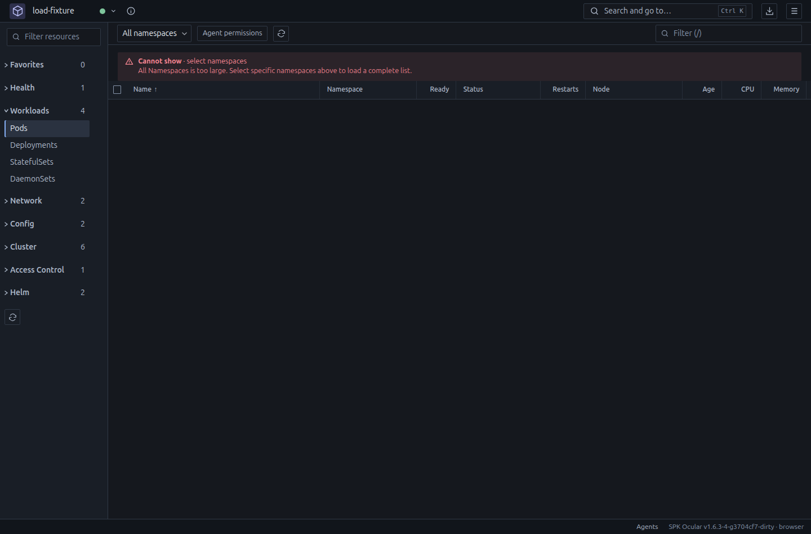
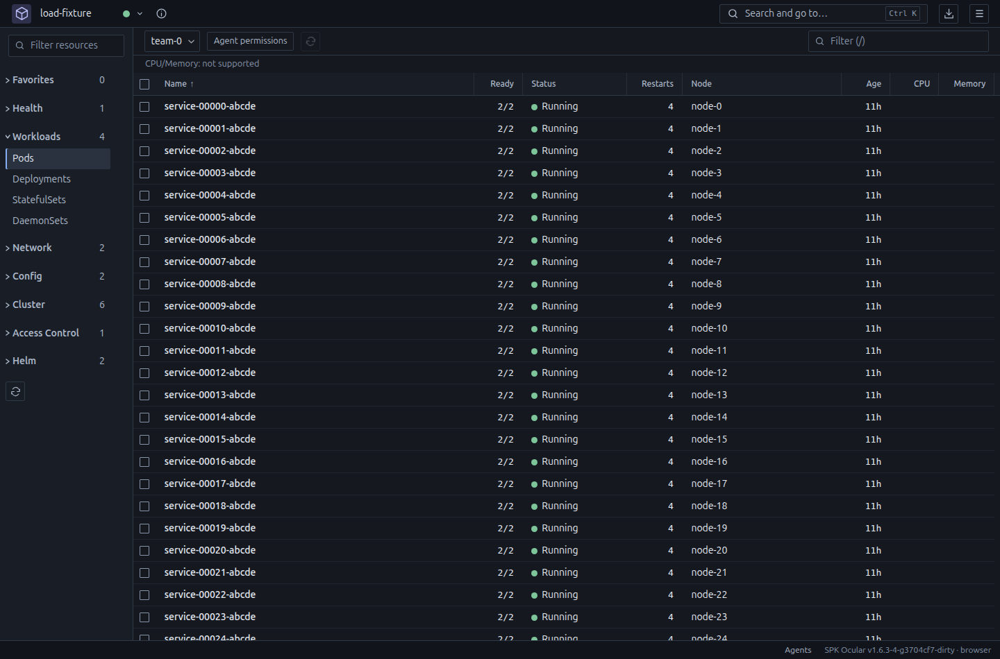
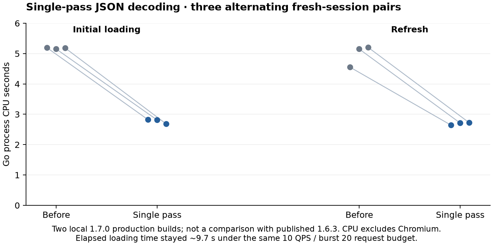
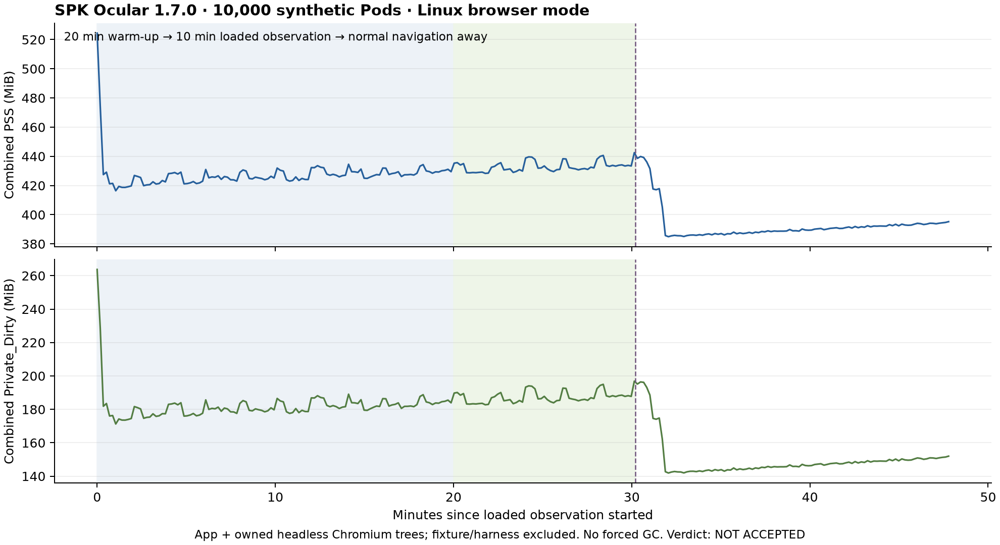

# Kubernetes inventory load and memory measurements

The latest production-build measurements are from **16.10.2026**: three paired
CPU comparisons and a separate 47.78-minute memory observation. Initial loading
used 45.75% less Go CPU after the JSON decoder change, while elapsed loading
remained about 9.7 seconds under the same request budget. The largest sampled
combined app/Chromium PSS across six valid current-build sessions was
**557.947 MiB**. The memory stability protocol returned **NOT ACCEPTED**; do not
advertise a confirmed plateau or a before/after memory reduction. See the
[current CPU comparison](#production-build-cpu-comparison-on-16102026) and
[current memory observation](#production-build-memory-observation-on-16102026).
Earlier fixtures and their raw data below remain identified separately.

The original measurements below were collected on 2026-10-15. They describe a local development candidate,
not a published release or a certification of arbitrary production clusters.
The application version remained 1.6.3. The source base was commit
`3704cf7d643573e8a8c1888139b1189b061358e2` plus the inventory/refresh changes.
The full-soak snapshot's changed code/test file manifest has SHA-256 fingerprint
`98ed186a915b642ef033c96957caf47b2661b7d92a9205b5321451c65aa4b6e6`
(sorted `path SHA256` lines, excluding documentation). Other snapshots are
identified in the accompanying metadata. Measurements include real
HTTP clients and an actual application/browser process, with synthetic data.

## Environment and method

- Shared Linux Mint 22.3 workstation, kernel 6.17.0-20-generic, amd64.
- AMD Ryzen 7 260, 8 cores / 16 logical CPUs, approximately 60.6 GiB RAM.
- Go 1.26.9, Node 22.22.2, pnpm 10.33.0, Playwright 1.63.0;
  Chrome for Testing headless shell 153.0.8010.12.
- Native functional checks: GTK 3.24.41 / WebKitGTK 2.52.3 on a private Xvfb.
  These checks establish behavior/layout, not GPU rendering performance.
- No user application, production cluster or Docker daemon was used or restarted.
  The HTTP fixtures, application profiles, Chromium and Xvfb belonged to the test.

Two distinct synthetic Pod shapes were used. The Go wire-level test uses
`realisticPod` from `internal/providers/kubernetes/synthetic_test.go`: two
containers, 20 environment variables each, resource declarations, volume mounts,
labels, annotations, owner references, four managedFields entries and container
statuses. The browser fixture uses a similar, somewhat smaller Pod shape,
10,000 distinct objects in one selected namespace and 40 namespace names.
Its metrics endpoint is absent. Do not combine the two fixtures' byte totals
or treat either as a representative distribution for every real cluster.

The fake API implements actual `limit`/`continue` HTTP pages, a consistent
resourceVersion, `remainingItemCount`, and a watch stream. It rejects WatchList
so the application exercises its LIST-to-WATCH fallback. It is not an API-server,
etcd or admission-controller benchmark. Native selected-object checks also
honor `metadata.name` field selectors; individual-object requests are counted
separately from collection LISTs.

## Behavior being measured

Only a demanded kind and its selected namespace routes are loaded. A complete
list is assembled from automatic 100-object pages; every page is reduced to
compact cache objects before fetching the next. Search and sorting by inventory
fields remain local and complete. CPU/RAM metrics are sampled separately; their
existing sort freezes available samples and places unknown values last. This
work does not establish a complete CPU/RAM ranking, and the fixture has no
metrics-server. There is no user-visible pagination. Watches maintain the cache;
normal navigation back to a warm view does not perform another full Pod LIST.
An unfinished inventory is cancelled when its last consumer closes it.

All session HTTP clients share a sustained 10 read requests/second budget,
burst 20, and four finite response bodies. Watch establishment pays the rate
budget; a live stream does not occupy a finite-body slot for its lifetime.
Existing stricter client-go throttles remain. This is not a bound on watch event
rate, server CPU or all traffic generated by every feature.

Idle retention is limited to eight caches, 25,000 objects and 32 MiB of compact
payload plus identity strings. These are idle-cache budgets, not total process
memory caps. Active explicitly selected collections remain complete.

All Namespaces for a namespaced live collection has admission limits of 2,000
objects, 16 MiB of current raw encoded objects and 8 MiB per finite LIST response
through the session transport. A remaining-count estimate can reject the broad
collection after its first page. Without an estimate, actual observations enforce
the bound; watch growth is checked too. Failure stops that cache and clears its
rows instead of presenting a partial successful list. Explicit namespaces are
then required. Snapshot tools such as Graph retain their own explicit admission,
resource/page/byte budgets and coverage reporting.

## HTTP inventory results

| Run | Instrumentation / read budget | Rows | LIST requests | JSON response bytes | Elapsed |
| --- | --- | ---: | ---: | ---: | ---: |
| Earlier complete-cache baseline | no race; client defaults, without the new shared budget | 10,000 | 20 | 55,083,175 | 2.809 s |
| Current complete selected namespace | no race; production client settings plus shared 10 QPS / burst 20 | 10,000 | 100 | 55,126,575 | 8.438 s |
| Current selected namespace regression run | race; same shared budget | 10,000 | 100 | 55,126,575 | 24.168 s |

Each completed run established one watch after the list. The byte totals are
nearly unchanged: retaining full search/sort still requires the complete selected
collection. Smaller pages and pacing control bursts and transient object
lifetimes; they are not a claim that the full list is no longer transferred.

These rows compare request shapes, not an isolated speed improvement. The old
baseline had larger pages and no new shared read budget. The current candidate
intentionally spreads reads over more, smaller requests. Race instrumentation
also changes elapsed time substantially; it is reported separately.

The real application/browser scenario verified:

- All Namespaces: one 100-object Pod page, then the admission message and zero
  visible partial rows. The first-page estimate describes 10,000 total Pods.
- Explicit namespace: 100 pages return all 10,000 Pods, followed by one Pod watch.
- Forced refresh: another 100 pages / 10,000 Pods, old rows retained until the
  complete replacement is ready; the icon spins during the operation.
- Search finds `service-09999-abcde`, the last object in the collection.
- Warm Nodes-to-Pods navigation issues no additional Pod LIST.
- Zero individual Pod GETs during load, filter, refresh and warm navigation.
  Full row objects on the LIST wire are not the same as individual detail GETs:
  ordinary Kubernetes LIST can still return fields discarded by the projection.
- One 40-object namespace inventory is shared by the UI. Limit-one connection
  and scope permission probes are separate and are included in request counters.

A private-Xvfb GTK run also verified the 10,000-object selected namespace,
last-object filtering, descending sorting and retained rows during refresh.
The selected-object observer honored `metadata.name` and returned one object,
not another full collection. A final-build 100-row GTK check counted zero
individual Pod GETs before opening details. Opening one Pod and its tools made
six GETs, all for that selected Pod. Typing a row filter while the drawer stayed
open caused no further Pod LIST or GET. This is demand-only description loading,
not a claim that opening a selected object always needs exactly one GET.

A regression found during this check was fixed: allocating an equivalent `Ref`
on parent renders must not repeat the port-info request. The test fails before
(2 calls instead of 1), then passes with stable identity plus explicit revision
tracking. A revision or UID change still reads fresh information. Catalog refresh
also rejects old-target continuations and old-session errors.

Without `remainingItemCount`, a dense 10,000-object HTTP fixture stops after
21 LISTs and 2,001 returned objects, with no watch and no partial successful rows.
The probe after 2,000 objects requests one item. Empty filtered pages resume
normal page sizes: a continuation alone is not proof of another matching object.
The five-second race-test deadline is unchanged. This admission deadline test
prepares identical response bodies before opening the observation, so synthetic
server object construction/JSON encoding is not charged to the client deadline.
Request counts, object counts, body contents and no-partial-result assertions
are unchanged. Throughput measurements above still generate pages on demand;
this fixture setup change is not a product speedup claim. Raw JSON size accounting avoids
serializing a second full copy; equivalence tests cover escaping, UTF-8, nils,
numeric values and real Pod shapes. The 16 MiB byte budget is unchanged.
Twenty-one requests is this dense fixture's result, not a universal page-count
cap for filtered APIs.





These unmodified screenshots show the measured synthetic fixture. A screenshot
of virtualized rows is not by itself evidence of the total inventory size; the
HTTP counters and complete-search checks establish that separately.

## Retained-object representation experiment

This is an isolated Go `HeapAlloc` experiment after garbage collection, not
application RSS/PSS and not the size of a whole browser or native window.
MB and KB in this table are decimal units, matching the test output.

| Representation of 10,000 Pods | Retained Go heap | Per Pod |
| --- | ---: | ---: |
| Full unstructured maps | 253.1 MB | 25.3 KB |
| Whitelisted unstructured maps | 63.9 MB | 6.4 KB |
| Whitelisted JSON byte slices | 11.8 MB | 1.18 KB |
| Compact informer objects: typed identity plus JSON body | 14.9 MB | 1.49 KB |

Expanding and projecting all 10,000 compact objects took 114.2 ms in that run.
Compact informer objects already existed before this phase. These representation
figures must not be advertised as a newly measured 17-fold reduction of the
whole application. Early page compaction reduces the lifetime of full maps;
this experiment alone does not establish its causal effect on application peaks.

## Application and Chromium memory

The process measurement includes the application and all descendants of the
owned headless Chromium server. It excludes the Python fixture, the measurement
script, unrelated browsers and user applications. The actual window has 10,000
rows in its data model and a virtualized DOM; this is not a bare cache benchmark.

Private_Dirty is the primary growth metric. PSS also includes a proportional
share of shared pages and can change as other processes start or exit. It is
reported for reference and is not interchangeable with retained Go heap or RSS.
Process-tree swap is checked separately; host-wide swap usage is not attributed
to the test. At least 8 GiB of host memory had to be available at the start.

Sampling is every 10 seconds: 20 minutes of warm-up, 10 more minutes with the
selected Pod inventory open, then Nodes, two minutes of settling and at least
10 minutes of after-load observation were originally scheduled. The current
owner-clarified rule separates unloading from the **subsequent** control window:

1. Compute time-weighted averages over two adjacent one-minute windows. The
   difference must stay within ±0.5 MiB for one minute; the recent averages
   must also stay within a 1 MiB band during confirmation. This is a practical
   noise tolerance, not proof of a mathematically zero slope.
2. Only after confirmation start a new ten-minute control window. Confirmation
   time is not credited to that window. A further decline exceeding 0.5 MiB
   between the adjacent averages, or 1 MiB below the mean at control start,
   invalidates it and returns to unloading/confirmation. The cumulative check
   prevents a slow decline from being mistaken for a final plateau.
3. Samples must be strictly ordered. A gap over one minute invalidates the
   candidate/control window; means use time weights and interpolate only between
   valid adjacent samples. One-minute and ten-second collectors are supported.
4. Retain the 100 MiB loaded-phase/return budgets, maximum 15 MiB upward rebound
   from a preceding post-load minimum, and maximum 5 MiB net control growth.
   Growth violations are not erased by restarting the plateau timer. If there
   is no confirmed plateau followed by ten minutes, return **INCOMPLETE**, not
   success. A missing warmed-up baseline also prevents a full-soak acceptance.

`settling`, `after`, `idle` and `done` are all post-load labels: a fixed settling
phase does not itself prove that unloading has ended. These detector defaults
are explicit implementation choices; the measurement duration is not extended
automatically. No forced garbage collection is used.

The original evaluator returned **NOT ACCEPTED** for absolute range 11.781 MiB.
The first correction returned **ACCEPTED** when considering only upward growth;
the owner then clarified that this omitted the required plateau-first timing.
Both historical verdicts and the unchanged raw samples are preserved. The current
assessment is **INCOMPLETE** for both runs: the detector does not establish a
confirmed plateau with ten subsequent minutes in the available data. This is
insufficient stabilization evidence, not an observed growth-budget failure or
a newly measured application regression.

| Case | Observed interval | Private_Dirty | Range / drift | Current assessment |
| --- | --- | --- | --- | --- |
| Full run: loaded phase after 20-minute warm-up | minutes 20–30 | 166.4–169.3 MiB; baseline 166.855 MiB | maximum +2.4 MiB over baseline | Within the 100 MiB growth budget |
| Full run: original tail after fixed two-minute settling | 10.07 minutes, 61 samples | 135.254 → 124.375 MiB; minimum 123.473 MiB | range 11.781 MiB; drift −10.879 MiB; rebound 1.969 MiB | **INCOMPLETE**: no confirmed plateau followed by a full control window |
| Separate targeted follow-up: original final window | 10.05 minutes, 61 samples, after fixed five-minute settling | 127.004–129.176 MiB; first 127.152, last 127.887 MiB | range 2.172 MiB; drift +0.734 MiB | **INCOMPLETE** under plateau-first timing; historical targeted growth check passed |

The first run lasted 42.24 minutes and collected 253 samples. The follow-up
lasted 20.11 minutes and collected 121 samples: five minutes loaded, five minutes
settling, ten minutes idle. It sampled the after-load condition separately;
it does not replace the 20-minute-warm-up growth measurement. Neither its 100/10/5
limits nor the existing test timeouts were increased. No forced GC was used.

Both process trees had zero sampled swap. The Pod LIST count stayed at 201
(one rejected broad page, 100 selected pages and 100 refresh pages). After release,
only the current empty Node view/cache remained; idle caches were zero. All
sampled processes exited at the end. The follow-up's loaded baseline was
172.191 MiB; its idle maximum was within the same 100 MiB return budget.

PSS varied from 304.6 to 368.9 MiB in the first run's loaded post-warm-up phase,
and from 264.1 to 326.0 MiB in the follow-up's idle window, while Private_Dirty was
much steadier. These are shared-workstation measurements, not a dedicated-host
or native-WebKit memory result.

The measurements are attached to exact development artifacts in the
[metadata](performance-data/2026-10-15-metadata.json). Later selected-drawer,
catalog-owner and guard-byte-count fixes were verified separately. The measured
selected-namespace inventory/eviction path is unchanged; these scenarios reject
the broad read by remaining-count estimate before the per-object byte counter.
Do not describe the earlier soak executable as containing every later fix.

Raw samples omit process IDs, local paths, server URLs and tokens:

- [Full 42-minute run: 253 samples](performance-data/2026-10-15-full-soak.csv)
- [Targeted after-load run: 121 samples](performance-data/2026-10-15-after-load.csv)

These CSVs permit an independent check of the intervals, growth and ordered
rebounds. Metadata distinguishes the original flatness verdict, intermediate growth-only
reassessment, current plateau-first assessment and separate targeted follow-up.

Earlier 60-second browser observations were approximately 348 MiB PSS at 5,000
Pods and 395 MiB at 10,000. Those short runs do not have the duration and lifecycle
of this soak. They do not establish a before/after memory reduction, nor do they
certify long-term flatness.

## Verification and reproduction

The full local gate passed: Go race tests, vet/lint (including native tags and
Windows/macOS vet), 800 frontend tests across 94 files, 199 browser tests,
46 packaging checks, 103 maintained documentation files and browser/native builds.
The added measurement document is also checked with the documentation validator.
All 168 frontend files were byte-identical to both binaries' embedded assets.
The measured browser binary and frontend hashes matched those verified artifacts.

The existing graph test also passed its unchanged 32 ms p90 budget:
7.0 ms for 10,000 nodes and 13.6 ms for 30,000. These are canvas paint/zoom
measurements in the synthetic browser scenario, not live cluster inventory
loading time or native GPU results.

From the repository, using the documented toolchain and solution scratch:

```sh
# Complete inventory through real dynamic-client HTTP; generated pages, no
# preloaded fake-client collection. This is opt-in because it loads 10,000 Pods.
OCULAR_LOAD_AUDIT=1 go test ./internal/providers/kubernetes \
  -run TestProductionLoadCompleteSelectedNamespace -count=1 -v

# Representation experiment, with explicit GC; not total application memory.
OCULAR_SYNTH=1 go test ./internal/providers/kubernetes -run Synthetic -count=1 -v

# Admission, continuation failure, refresh and cancellation regressions.
go test -race ./internal/providers/kubernetes ./internal/views \
  -run 'TestCompactPages|TestBroad|TestProductionLoad|TestRefresh' -count=1

python3 scripts/check-docs.py
```

The browser soak uses a separately owned fake HTTP server and isolated application
profile, counts the actual application/Chromium process trees, writes the measured
phase to each sample and evaluates the resulting CSV with
`scripts/soak-verdict.py`. The disposable kind load/churn and memory scripts in
[Development](development.md#performance-verification) support a separate real
cluster experiment; it was not run here and must not be presented as this result.

## What the results do not establish

- No live production API-server/etcd, network latency, authorization topology,
  metrics-server, churn-heavy watch recovery or arbitrary CRD distribution was
  benchmarked by the synthetic static-inventory runs.
- Kubernetes watch reconnect/expired-version behavior has regression coverage;
  this run does not prove that every real watch failure mode was reproduced.
- No runtime performance comparison with K9s, Headlamp or Radar was made.
  K9s source informed the complete shared-cache/local-search model; that is
  source analysis, not a comparative benchmark.
- No Wayland/GPU or full Windows/macOS interaction certification follows from
  these Linux browser and private-Xvfb checks.
- Complete search/sort requires retaining the selected collection or an index.
  The active collection is compact, not constant-memory as its size grows.

A defensible blog statement is that the measured candidate loads complete
selected inventories in small internally budgeted pages, reuses them through
watch, blocks accidental oversized All Namespaces reads, and avoids opening a
full resource description for every row. Claims of zero API load, a fixed whole-app
memory cap, universal production safety or competitor superiority are unsupported.

## Primary references

- [Kubernetes consistent list chunks](https://kubernetes.io/docs/reference/using-api/api-concepts/#retrieving-large-results-sets-in-chunks)
  describe the limit/continue/resourceVersion contract.
- [client-go reflector v0.37.1](https://github.com/kubernetes/client-go/blob/v0.37.1/tools/cache/reflector.go)
  distinguishes watch-cache RV=0 behavior from real pagination; merely setting
  Limit does not prove a bound on every server response.
- K9s source pinned to `6450b4055e923e2a1d52552ac140cc9683e4fb6c`:
  [shared informer factory](https://github.com/derailed/k9s/blob/6450b4055e923e2a1d52552ac140cc9683e4fb6c/internal/watch/factory.go)
  and [local table filtering/sorting](https://github.com/derailed/k9s/blob/6450b4055e923e2a1d52552ac140cc9683e4fb6c/internal/ui/table.go).
  K9s was inspected as source, not executed as a performance comparator.

## JSON decoding cost in the inventory gate

The unchanged wire-level regression scenarios were compared locally with Go
1.26.9, the race detector, `GOMAXPROCS=2` and no concurrent owned build or graph
fixture. The server dynamically generated the selected-namespace responses; the
no-estimate admission fixture used its existing identical prepared HTTP bodies.
The baseline used client-go v0.37.1's repeated LIST decoding; the candidate uses
one integer-preserving JSON map decode with the same objects and response bytes.

| Scenario | Baseline | Single-pass candidate | Unchanged deadline |
| --- | ---: | ---: | ---: |
| All admission followed by complete 10,000-object selected namespace | 25.23 s | 12.11 s | 30 s for selected readiness |
| All admission without a remaining-count estimate, 2,001 objects / 21 LISTs | 4.76 s | 2.33 s | 5 s for admission error |

These are single local test observations under race instrumentation, not API
server latency or universal production speed guarantees. The first scenario's
reported test duration includes its initial broad rejection and setup, while its
30-second assertion applies to subsequent selected readiness. The separate failed
GitHub run exceeded both assertions; it published no release. Profiling identified
the upstream envelope/item reparsing, and decoder compatibility tests cover typed
item inference, pagination, large integers, malformed envelopes and API errors.
This timing comparison does not replace or complete the memory plateau protocol.

## Production-build CPU comparison on 16.10.2026

Three alternating pairs of fresh application sessions compared the production
1.7.0 build before and after the single-pass JSON decoder. Both builds used the
same Go 1.26.9 production flags, embedded frontend, 10,000-Pod HTTP fixture,
100-object pages and shared 10 QPS / burst 20 request budget. This comparison is
between two local 1.7.0 builds, **not against the published 1.6.3 release**.

| Observation | Before decoder change | Single-pass decoder | Change |
| --- | ---: | ---: | ---: |
| Initial loading, Go process CPU median | 5.180 s (5.150–5.190) | 2.810 s (2.680–2.820) | −45.75% |
| Explicit refresh, Go process CPU median | 5.150 s (4.550–5.200) | 2.710 s (2.640–2.720) | −47.38% |
| Connect to complete list, elapsed median | 9.752 s | 9.758 s | Effectively unchanged |
| Explicit refresh, elapsed median | 9.697 s | 9.690 s | Effectively unchanged |

CPU time is the Go application's `/proc/PID/stat` user plus system ticks,
divided by the operating system's `CLK_TCK`, between the corresponding UI
operation and complete-list readiness. It excludes Chromium CPU, the HTTP
fixture and the measurement harness. Each pair used new processes and profiles;
all six sessions exited cleanly. No other owned heavy test or build ran beside
the comparison. No garbage collection or cache purge was forced.



[CPU chart as SVG](images/inventory-cpu-2026-10-16.svg). Every dot is one
measured session; connecting lines retain the alternating pair identity.

The request pacing dominates elapsed loading time in this fixture. Reduced Go
CPU time therefore does not mean a corresponding reduction in user waiting
time. Each load still transfers all 10,000 selected objects: 100 Pod LIST
responses and 39,566,575 JSON body bytes (37.73 MiB). Warm navigation issued no
additional Pod LIST. Before selecting a row there were no individual Pod GETs;
the selected-object observer's named LIST returned exactly that one Pod.

The measured single-pass executable has SHA-256
`2e22b65b36dd654815209863569f31a55b1c16301b87a5b33b7876dc322d517b`
and source `a01cee524fb40ce94170e230fc5cf7a3a43b2bb2`. The independently checked candidate
`6bafa1cadfe0f346856f475458b3c8ccc76f8eae` has identical application runtime
inputs. Subsequent test, documentation and native capture-helper corrections are
not new CPU measurements. Published platform binaries are rebuilt and verified
separately; they are not claimed byte-identical to this measured local artifact. The earlier executable's
SHA-256 is
`0392b178ea0089120006cb3568be4f9ca74429462984f0574ba3d65762475119`.
[Raw CPU observations and summary](performance-data/2026-10-16-cpu.json) retain
every pair, executable hash and unrounded result. These CPU results establish neither a before/after memory reduction nor native
window performance on other operating systems.

## Production-build memory observation on 16.10.2026

The same production GTK executable ran in `--browser` mode with owned headless
Chromium. Memory is the **sum of both process trees**, excluding the HTTP fixture,
measurement harness and unrelated applications. It is not native-WebKit window
memory. The synthetic fixture and application input match the CPU comparison;
this is not a real-cluster churn or API-server benchmark.

Across two fixture-validation sessions, three current-build CPU sessions and the
long observation, the largest sampled PSS was **557.947 MiB** and the largest
Private_Dirty was **300.789 MiB**, both during explicitly selected-object details
in one validation session. The long observation itself peaked at **527.582 MiB
PSS / 266.156 MiB Private_Dirty**. Peaks are sampled observations, not guaranteed
upper bounds. They are not directly comparable to the earlier 10-second-sampled
pure-Go candidate above. No before/after RAM reduction is established.

The long run collected 275 criterion samples over 47.78 minutes, plus 5,248
nominally 0.5-second process-tree samples including the interaction prelude.
It completed 20 minutes of warm-up and a separate full 10-minute loaded
observation, then switched normally to Nodes while retaining the connection.
No forced garbage collection, cache purge or application restart was used.

| Criterion | Observation | Result |
| --- | --- | --- |
| Loaded Private_Dirty growth | Baseline 189.723 MiB; maximum +7.152 MiB | Within unchanged 100 MiB budget |
| Post-load return | Private_Dirty fell to about 141.9 MiB in criterion samples | Within unchanged 100 MiB return budget |
| Ordered post-load upward excursion | +10.082 MiB, about 17.6 minutes after navigation | **Exceeded unchanged 10 MiB limit** |
| Plateau followed by separate control | No confirmed plateau / no control start | Not established |
| Process-tree swap | Zero throughout | Passed |



[Memory chart as SVG](images/inventory-memory-2026-10-16.svg). The line uses
the ten-second criterion samples from the separate long run; its visible peak
is not the six-session maximum reported above.

Under the original 10 MiB rebound criterion, the verdict was **NOT ACCEPTED**.
The detector stopped the observation when the upward-excursion limit failed;
it did not use the remaining 30-minute post-load cap to erase that failure.
The 60-second confirmation, separate 600-second control, 100/10/5 MiB budgets
and all existing test timeouts were unchanged. This demonstrates a failed
stability criterion; it does not by itself establish a retained-object leak or
its cause. A lower ending footprint is not a passing plateau measurement. The separate
15 MiB reassessment below supersedes this criterion for the current evaluation
without changing the original recording or verdict.

The high-frequency post-load minimum and final sample differ by 10.164 MiB:
8.496 MiB in the Chromium renderer and 1.551 MiB in the Go process, with small
changes in other Chromium processes. Those values use the high-frequency
samples, so they differ from the 10.082 MiB criterion result. At the end the Go
heap was about 6 MiB, the Pod cache was released, idle caches were zero and only
the current empty Node view/cache remained. These counters do not prove that
Chromium has no retained frontend objects.

Pod collection reads stayed at 202 LISTs / 20,101 returned objects: 100 initial
pages, 100 refresh pages, one rejected broad page containing 100 objects and
one named selected-object LIST containing exactly one Pod. Four individual GETs
were all for that explicitly selected Pod. There were no eager individual GETs
before selection and no additional Pod LIST during the long observation.
All application, Chromium and fixture processes closed cleanly with exit code 0.

- [Criterion CSV, 275 rows](performance-data/2026-10-16-memory.csv)
- [High-frequency memory CSV, 5,248 rows](performance-data/2026-10-16-memory-high-frequency.csv)
- [All six valid current-build sessions: raw peak samples](performance-data/2026-10-16-peak-samples.csv)
- [Artifact, protocol, all valid-run peaks, exclusions and hashes](performance-data/2026-10-16-metadata.json)

CSV times are relative seconds; local paths, URLs, tokens and process IDs are
omitted. Historical `*_mb` criterion columns contain MiB. Running
`python3 scripts/soak-verdict.py --rebound-limit-mib 10 docs/performance-data/2026-10-16-memory.csv`
reproduces the failed verdict without changing source memory values. Two early
short sessions and one interrupted long session are excluded because their
fixture ignored the selected-object `metadata.name` field selector. Their
original evidence is retained; the corrected fixture's named read returns one
Pod. Those excluded runs are not alternate memory acceptance results.

A separate six-minute targeted diagnostic used Chromium's `Runtime.getHeapUsage`
and `Memory.getDOMCounters` every ten seconds after the same interaction
prelude and normal navigation to Nodes. It did not force GC or purge memory.
After the first ten seconds the DOM stayed at 313 nodes; sampled JS heap
repeatedly fell naturally rather than increasing monotonically. This short
instrumented observation does not identify the source of the long run's
Private_Dirty rebound, establish leak freedom or replace its **NOT ACCEPTED**
verdict. All diagnostic processes exited with code 0.
[Raw targeted heap/DOM observations](performance-data/2026-10-16-heap-diagnostic.csv)
keep this experiment separate from the acceptance data.


## Reassessment with the owner-selected 15 MiB rebound tolerance

The current evaluator defaults to a 15 MiB post-load upward-excursion budget.
The 100 MiB phase/return budgets, 5 MiB net control-growth budget, plateau
confirmation, separate ten-minute control and sampling rules are unchanged.
Original raw samples and reports retain their original assessment; a new
criterion can be applied to those same samples without rerunning the application.

Reevaluating all 275 criterion samples from 16.10.2026 with the current default:

```sh
python3 scripts/soak-verdict.py docs/performance-data/2026-10-16-memory.csv
```

The 10.082032 MiB rebound is within 15 MiB. Loaded growth remains +7.152 MiB
and process-tree swap remains zero. The overall reassessment is **INCOMPLETE**:
the unchanged plateau detector finds no confirmed plateau followed by a separate
ten-minute control (`control_start_seconds: None`, `control_seconds: 0`). This is
a reassessment of the existing recording, not a new soak or an accepted stability
claim. Use `--rebound-limit-mib 10` to reproduce the original **NOT ACCEPTED**
result; neither assessment changes the measured peak PSS of 557.947 MiB.
